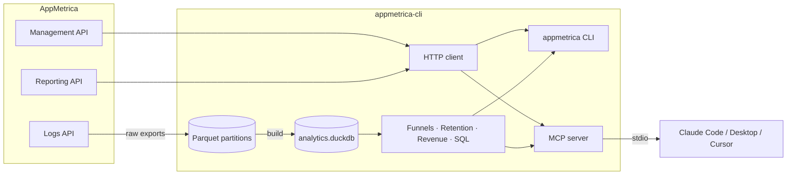

# appmetrica-cli

**Read-only CLI and MCP server for [AppMetrica](https://appmetrica.yandex.com/) game analytics.** Ask analytics questions in plain language from Claude Code, Claude Desktop, or Cursor — no dashboards, no spreadsheets.

[Русская версия](./README.ru.md)


## Why

AppMetrica's own dashboards are built for scrolling and clicking. This tool is built for asking:

- *"What's DAU by country for the last 30 days?"*
- *"Build a funnel from `level_start` to `level_finish` for the US, Facebook only"*
- *"D3/D1 retention ratio for the cohort that installed May 1–7"*
- *"Compare Facebook vs organic cohorts on retention and session count"*

It talks to AppMetrica's real APIs, keeps raw Logs API exports in a local Parquet store and rebuilds a DuckDB analytics database when a question needs raw data (funnels, retention, revenue, SQL), and hands the numbers to your LLM client as MCP tools — or straight to your terminal as JSON.

## Features

- 🔒 **Read-only by construction.** Every HTTP call is a `GET`. No write endpoint is ever called.
- 🔑 **Token stays out of plaintext.** Stored in the OS credential store (macOS Keychain, Windows Credential Manager, Linux Secret Service) — never written in plaintext, never printed, never logged.
- 📊 **22 MCP tools** — 11 over the Reporting API (discovery, ad-hoc queries, preset reports) and 11 over the local store (sync, build, daily metrics, retention, revenue, funnels, SQL, discovery, reconciliation).
- 🧠 **Local Parquet store + rebuildable DuckDB.** Logs API exports land in `<table>/day=*.parquet` partitions; `build` compiles them into `analytics.duckdb`. Partitions are replaced as a whole, so re-running `sync` is safe and never appends duplicates.
- 🧪 **SQL sandbox.** `sql` / `run_sql` executes one read-only `SELECT`/`WITH` statement over the analytics database — at most 10,000 rows and 60 seconds.
- 🗂️ **No hardcoded event taxonomy.** You tell it your event names (`level_start`, `iap_purchase`, whatever your game calls them); it never assumes a schema.
- 🖥️ **CLI + MCP in one package.** Same auth, same client, two ways in.

## How it works



- **Management API** — list the apps your token can see (`appmetrica apps`).
- **Reporting API** — aggregated metrics (DAU, sessions, crashes, installs, geo). Fast, no local storage.
- **Logs API** — raw event, install, session-start, IAP and ad revenue export (async: `202` → poll → `200`). `sync` writes one Parquet partition per table and receive day; `build` recompiles all partitions into `analytics.duckdb`.
- **Local reports** — daily metrics, retention, revenue, funnels, event discovery and SQL read the rebuilt database, so the usual loop is `sync` → `build` → `report`.

## Quick start

Requires [uv](https://docs.astral.sh/uv/) — it installs the Python ≥3.10 the project needs by itself.

```bash
# macOS or Linux
curl -LsSf https://astral.sh/uv/install.sh | sh
# or, with Homebrew:
brew install uv
```

```powershell
# Windows (PowerShell)
powershell -ExecutionPolicy ByPass -c "irm https://astral.sh/uv/install.ps1 | iex"
```

Step-by-step guide for non-developers (in Russian): [docs/setup-guide.md](./docs/setup-guide.md).

```bash
# 1. Clone and install
git clone https://github.com/ampersante/appmetrica-cli.git
cd appmetrica-cli
uv sync

# 2. Get an AppMetrica OAuth token (see below), then log in
uv run appmetrica auth login

# 3. Check it's working
uv run appmetrica auth status

# 4. Find your app id (needed by sync/build/report)
uv run appmetrica apps

# 5. Start the MCP server
uv run appmetrica mcp
```

### Getting an AppMetrica OAuth token

1. Go to [oauth.yandex.com/client/new](https://oauth.yandex.com/client/new) and create an app.
2. Grant it the **`appmetrica:read`** permission (read-only access to AppMetrica).
3. Follow Yandex OAuth's flow to obtain a token for that app.
4. Run `appmetrica auth login` and paste the token when prompted (or pipe it: `appmetrica auth login --stdin`).

The token is validated against the API immediately and then stored in your OS credential store — it is never written to disk in plaintext.

## CLI usage

```bash
$ appmetrica auth login
AppMetrica OAuth token: ********
{
  "stored_in": "keychain",
  "apps_visible": 3
}

$ appmetrica auth status
{
  "source": "keychain",
  "valid": true,
  "apps_visible": 3
}

$ appmetrica apps
[
  {
    "id": 123456,
    "name": "My Game",
    "time_zone_name": "Europe/Berlin"
  }
]

$ appmetrica sync --app 123456 --from 2026-10-23 --to 2026-10-23 --tables events
# progress lines go to stderr
{
  "app_id": 123456,
  "from": "2026-10-23",
  "to": "2026-10-23",
  "fetched": [
    {
      "table": "events",
      "day": "2026-10-23",
      "rows": 51234
    }
  ],
  "skipped_closed": 0,
  "error": null
}

$ appmetrica build --app 123456
{
  "events": 1234567,
  "installations": 45678,
  "sessions_starts": 890123,
  "revenue_events": 2345,
  "ad_revenue_events": 6789
}

$ appmetrica report --app 123456 --from 2026-10-01 --to 2026-10-02
[
  {
    "day": "2026-10-01",
    "dau": 1234,
    "sessions": 5678,
    "installs": 90
  },
  {
    "day": "2026-10-02",
    "dau": 1250,
    "sessions": 5700,
    "installs": 85
  }
]

$ appmetrica auth logout
{
  "deleted": true
}

$ appmetrica mcp
# starts the MCP server over stdio
```

`auth status` and `auth login` never print the token itself — only where it came from and whether it works. Exit codes are stable and scriptable: `2` = API rejected the token, `3` = credential-store error, `4` = configuration error (bad token format, conflicting env vars, unsafe token file permissions).

For servers/CI without an OS credential store, set `APPMETRICA_OAUTH_TOKEN` directly, or point `APPMETRICA_OAUTH_TOKEN_FILE` at a file owned by the running user with `chmod 600` permissions.

Most local commands read the analytics database and need no token:

| Command | What you get |
|---|---|
| `retention --app ID [--days 1,7] [--from D] [--to D]` | D-N retention per non-reinstall install cohort |
| `revenue --app ID [--from D] [--to D] [--ad] [--by-network]` | IAP revenue in USD per day (converted with ECB rates); `--ad` adds raw ad revenue per currency |
| `funnel --app ID --steps JSON [--window 7d]` | Device-level funnel; the window is measured from the entry, e.g. `'[{"event_name": "open"}, {"event_name": "buy"}]'` |
| `sql --app ID "SELECT ..."` | One read-only `SELECT`/`WITH` over `analytics.duckdb`, capped at 10,000 rows and 60 seconds |
| `events --app ID [--event NAME]` | Loaded events with volume and reach, or the parameters of one event |
| `reconcile --app ID [--from D] [--to D]` | Local DAU/sessions/installs compared with the Reporting API (needs a token) |

A token is required only by `auth`, `apps`, `sync` and `reconcile`. On first `revenue` run the ECB rate archive (`eurofxref-hist.zip`) is downloaded into `~/.appmetrica-cli/fx/`.

Data lives under `~/.appmetrica-cli/apps/<app_id>/`: one Parquet file per table and receive day (`events/day=2026-10-23.parquet`, and so on) plus the rebuilt `analytics.duckdb`. Re-running `sync` replaces whole partitions, so it is safe to repeat and it fills in missing days.

## MCP usage

Add the server to your MCP client config (Claude Code `.mcp.json`, Claude Desktop config, Cursor, etc.), pointing `--project` at wherever you cloned the repo:

```json
{
  "mcpServers": {
    "appmetrica": {
      "command": "uv",
      "args": ["run", "--project", "/path/to/appmetrica-cli", "appmetrica", "mcp"]
    }
  }
}
```

Auth works the same way as the CLI — the server reads from the OS credential store (or `APPMETRICA_OAUTH_TOKEN` / `APPMETRICA_OAUTH_TOKEN_FILE`) at startup.

### 22 tools

| Group | Tools | Source |
|---|---|---|
| **Reporting API** | | |
| Discovery | `list_apps`, `list_metrics` | Management API |
| Universal query | `get_report`, `get_drilldown` | Reporting API |
| Preset reports | `get_traffic`, `get_installs`, `get_crashes`, `get_geo`, `get_events`, `get_devices`, `get_versions` | Reporting API |
| **Local store** | | |
| Sync | `sync` | Logs API → Parquet partitions |
| Build | `build` | Parquet → `analytics.duckdb` |
| Local reports | `get_daily_metrics`, `get_retention`, `get_iap_revenue`, `get_ad_revenue` | `analytics.duckdb` |
| Raw-data analytics | `build_funnel`, `list_events`, `explore_event_params`, `run_sql` | `analytics.duckdb` |
| Reconciliation | `reconcile` | Reporting API vs local store |

Plus two MCP prompt templates: `daily_analytics_check` and `compare_periods`.

`get_report` and `get_drilldown` accept any metric/dimension combination the Reporting API supports — call `list_metrics` first to see the live catalog. The preset tools cover the common questions (traffic, installs, crashes, geo, events, devices, versions) with a `group_by` shortcut.

The local-store tools work on what you have synced: `sync` fetches Logs API partitions, `build` rebuilds `analytics.duckdb`, and the report and raw-data tools read it. `build_funnel` takes event names or JSON steps with parameter filters and measures the window from the entry; `run_sql` runs one read-only `SELECT`/`WITH` statement (10,000 rows, 60 s); `reconcile` compares local DAU, sessions and installs with the Reporting API. Until `build` has run, local tools return an error telling you to build the database first.

## Security

- **Read-only.** Only `GET` requests are made against AppMetrica's APIs. There is no code path that writes, imports, or modifies anything in AppMetrica.
- **No plaintext token, ever.** The token lives in the OS credential store and is never written to a config file, log, or error message.

| Platform | Credential store | Verified |
|---|---|---|
| macOS | Keychain | Unit-tested; verified manually against a real Keychain |
| Linux | Secret Service | Unit-tested; verified manually in Docker against a real GNOME Keyring (login, read, delete) and without a keyring (clean refusal) |
| Windows | Credential Manager | Unit-tested (mocked backend) only — not run on real Windows yet |

- **CI / headless environments:** use `APPMETRICA_OAUTH_TOKEN` (env var) or `APPMETRICA_OAUTH_TOKEN_FILE` (a file that must be owned by the current user and have `600` permissions — checked before every read).
- **Scriptable failures.** Auth commands exit `2` (token rejected by the API), `3` (credential-store error), or `4` (configuration error), never a generic `1`, so wrapper scripts can branch on the actual cause.
- **No silent credential-store redirection.** The OS store is pinned per platform: `PYTHON_KEYRING_BACKEND` and `keyringrc.cfg` are ignored, and any `KEYRING_PROPERTY_*` variable makes auth refuse to run (exit `4`) instead of letting it change where the token is written.

## Roadmap

Not available yet — do not assume these exist:

- [ ] Packaged install (Homebrew / standalone binary) — for now, install from source with `uv`
- [ ] Verification against a live Logs API account: cross-check local DAU, sessions, installs and funnel numbers with AppMetrica's own reports
- [ ] Windows live check of the Credential Manager backend (unit-tested with a mocked backend only so far)
- [ ] License decision (see below)

## Contributing

```bash
uv sync --extra dev
uv run pytest -v
```

169 tests, no network calls in the test suite (HTTP is mocked with `respx`). PRs welcome — please keep the read-only guarantee intact and add tests for new code.

More detail on the internals: [architecture.md](./architecture.md) and [engineering-rules.md](./engineering-rules.md) (partly in Russian).

## License

Not chosen yet — the repository owner will pick a license before wider distribution. Until then, treat this as "all rights reserved" source-available code.
