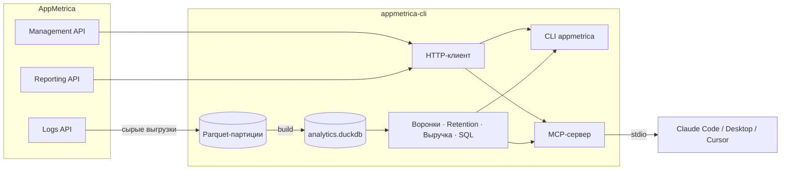

# appmetrica-cli

**Read-only CLI и MCP-сервер для игровой аналитики [AppMetrica](https://appmetrica.yandex.com/).** Задавайте аналитические вопросы на обычном языке прямо из Claude Code, Claude Desktop или Cursor — без дашбордов и таблиц.

[English version](./README.md)


## Зачем

Штатные дашборды AppMetrica заточены под скроллинг и клики. Этот инструмент — под вопросы:

- *«Какой DAU по странам за последние 30 дней?»*
- *«Построй воронку level_start → level_finish для США, только Facebook»*
- *«Какое соотношение D3/D1 retention у когорты, установившей приложение 1–7 мая?»*
- *«Сравни когорты Facebook и organic по retention и числу сессий»*

Инструмент обращается к реальным API AppMetrica, хранит сырые выгрузки Logs API в локальном Parquet-хранилище и пересобирает из них DuckDB-базу аналитики, когда вопросу нужны сырые данные (воронки, retention, выручка, SQL), и отдаёт числа вашему LLM-клиенту как MCP-инструменты — либо сразу в терминал в виде JSON.

## Возможности

- 🔒 **Read-only по конструкции.** Каждый HTTP-запрос — `GET`. Ни один write-эндпоинт никогда не вызывается.
- 🔑 **Токен не хранится в открытом виде.** Хранится в системном хранилище учётных данных (macOS Keychain, Windows Credential Manager, Linux Secret Service) — никогда не записывается в открытом виде, никогда не печатается, никогда не логируется.
- 📊 **22 MCP-инструмента**: 11 поверх Reporting API (discovery, произвольные запросы, пресеты) и 11 поверх локального хранилища (sync, build, метрики по дням, retention, выручка, воронки, SQL, исследование событий, сверка с API).
- 🧠 **Parquet-хранилище и пересобираемая DuckDB.** Выгрузки Logs API ложатся в партиции `<таблица>/day=*.parquet`; `build` собирает из них `analytics.duckdb`. Партиции заменяются целиком, поэтому повторный `sync` безопасен и никогда не создаёт дубликатов.
- 🧪 **SQL-песочница.** `sql` / `run_sql` исполняет один read-only `SELECT`/`WITH` по базе аналитики — не больше 10 000 строк и 60 секунд.
- 🗂️ **Никакой зашитой таксономии событий.** Вы сами называете свои события (`level_start`, `iap_purchase` — любые названия вашей игры); сервер никогда не предполагает готовую схему.
- 🖥️ **CLI и MCP в одном пакете.** Общая авторизация, общий клиент, два способа доступа.

## Как это работает



- **Management API** — список приложений, доступных вашему токену (`appmetrica apps`).
- **Reporting API** — агрегированные метрики (DAU, сессии, крэши, установки, гео). Быстрые ответы, без локального хранения.
- **Logs API** — экспорт сырых событий, установок, стартов сессий, IAP и ad revenue (асинхронно: `202` → опрос → `200`). `sync` пишет по одной Parquet-партиции на таблицу и receive-день; `build` пересобирает все партиции в `analytics.duckdb`.
- **Локальные отчёты** — метрики по дням, retention, выручка, воронки, исследование событий и SQL читают пересобранную базу; обычный цикл — `sync` → `build` → `report`.

## Быстрый старт

Нужен Python ≥3.10 и [uv](https://docs.astral.sh/uv/).

Пошаговый гайд для не-разработчиков: [docs/setup-guide.md](./docs/setup-guide.md).

```bash
# 1. Клонировать и установить
git clone https://github.com/ampersante/appmetrica-cli.git
cd appmetrica-cli
uv sync

# 2. Получить OAuth-токен AppMetrica (см. ниже), затем авторизоваться
uv run appmetrica auth login

# 3. Проверить, что всё работает
uv run appmetrica auth status

# 4. Узнать id своего приложения (нужен для sync/build/report)
uv run appmetrica apps

# 5. Запустить MCP-сервер
uv run appmetrica mcp
```

### Как получить OAuth-токен AppMetrica

1. Перейдите на [oauth.yandex.com/client/new](https://oauth.yandex.com/client/new) и создайте приложение.
2. Выдайте ему право **`appmetrica:read`** (доступ к AppMetrica только на чтение).
3. Пройдите стандартный флоу Yandex OAuth и получите токен для этого приложения.
4. Выполните `appmetrica auth login` и вставьте токен при запросе (либо передайте через пайп: `appmetrica auth login --stdin`).

Токен сразу проверяется реальным запросом к API, а затем сохраняется в системном хранилище учётных данных — он никогда не записывается на диск в открытом виде.

## Использование CLI

```bash
$ appmetrica auth login
AppMetrica OAuth token: ********
{
  "stored_in": "keychain",
  "apps_visible": 3
}

$ appmetrica auth status
{
  "source": "keychain",
  "valid": true,
  "apps_visible": 3
}

$ appmetrica apps
[
  {
    "id": 123456,
    "name": "My Game",
    "time_zone_name": "Europe/Berlin"
  }
]

$ appmetrica sync --app 123456 --from 2026-10-23 --to 2026-10-23 --tables events
# строки прогресса пишутся в stderr
{
  "app_id": 123456,
  "from": "2026-10-23",
  "to": "2026-10-23",
  "fetched": [
    {
      "table": "events",
      "day": "2026-10-23",
      "rows": 51234
    }
  ],
  "skipped_closed": 0,
  "error": null
}

$ appmetrica build --app 123456
{
  "events": 1234567,
  "installations": 45678,
  "sessions_starts": 890123,
  "revenue_events": 2345,
  "ad_revenue_events": 6789
}

$ appmetrica report --app 123456 --from 2026-10-01 --to 2026-10-02
[
  {
    "day": "2026-10-01",
    "dau": 1234,
    "sessions": 5678,
    "installs": 90
  },
  {
    "day": "2026-10-02",
    "dau": 1250,
    "sessions": 5700,
    "installs": 85
  }
]

$ appmetrica auth logout
{
  "deleted": true
}

$ appmetrica mcp
# запускает MCP-сервер поверх stdio
```

`auth status` и `auth login` никогда не печатают сам токен — только откуда он взят и работает ли он. Коды завершения стабильны и пригодны для скриптов: `2` — API отклонил токен, `3` — ошибка хранилища учётных данных, `4` — ошибка конфигурации (неверный формат токена, конфликтующие переменные окружения, небезопасные права на файл с токеном).

Для серверов/CI без системного хранилища учётных данных задайте `APPMETRICA_OAUTH_TOKEN` напрямую, либо укажите в `APPMETRICA_OAUTH_TOKEN_FILE` путь к файлу, принадлежащему текущему пользователю, с правами `chmod 600`.

Большинство локальных команд читают базу аналитики и токена не требуют:

| Команда | Что возвращает |
|---|---|
| `retention --app ID [--days 1,7] [--from D] [--to D]` | Retention D-N по когортам не-реинсталлов |
| `revenue --app ID [--from D] [--to D] [--ad] [--by-network]` | IAP-выручка в USD по дням (конвертация по курсам ECB); `--ad` добавляет сырую ad revenue по валютам |
| `funnel --app ID --steps JSON [--window 7d]` | Воронка на уровне устройства; окно отсчитывается от входа, например `'[{"event_name": "open"}, {"event_name": "buy"}]'` |
| `sql --app ID "SELECT ..."` | Один read-only `SELECT`/`WITH` по `analytics.duckdb`, лимит 10 000 строк и 60 секунд |
| `events --app ID [--event NAME]` | Загруженные события с объёмами, либо параметры одного события |
| `reconcile --app ID [--from D] [--to D]` | Локальные DAU/сессии/установки против Reporting API (нужен токен) |

Токен нужен только командам `auth`, `apps`, `sync` и `reconcile`. При первом запуске `revenue` архив курсов ECB (`eurofxref-hist.zip`), скачивается в `~/.appmetrica-cli/fx/`.

Данные лежат в `~/.appmetrica-cli/apps/<app_id>/`: по одному Parquet-файлу на таблицу и receive-день (`events/day=2026-10-23.parquet` и т.д.) плюс пересобранная `analytics.duckdb`. Повторный `sync` заменяет партиции целиком — его безопасно запускать повторно, он дозагружает недостающие дни.

## Использование через MCP

Добавьте сервер в конфиг вашего MCP-клиента (`.mcp.json` для Claude Code, конфиг Claude Desktop, Cursor и т.д.), указав в `--project` путь до склонированного репозитория:

```json
{
  "mcpServers": {
    "appmetrica": {
      "command": "uv",
      "args": ["run", "--project", "/path/to/appmetrica-cli", "appmetrica", "mcp"]
    }
  }
}
```

Авторизация работает так же, как в CLI — сервер при старте читает токен из системного хранилища (либо из `APPMETRICA_OAUTH_TOKEN` / `APPMETRICA_OAUTH_TOKEN_FILE`).

### 22 инструмента

| Группа | Инструменты | Источник |
|---|---|---|
| **Reporting API** | | |
| Discovery | `list_apps`, `list_metrics` | Management API |
| Универсальные запросы | `get_report`, `get_drilldown` | Reporting API |
| Пресет-отчёты | `get_traffic`, `get_installs`, `get_crashes`, `get_geo`, `get_events`, `get_devices`, `get_versions` | Reporting API |
| **Локальное хранилище** | | |
| Синхронизация | `sync` | Logs API → Parquet-партиции |
| Сборка | `build` | Parquet → `analytics.duckdb` |
| Локальные отчёты | `get_daily_metrics`, `get_retention`, `get_iap_revenue`, `get_ad_revenue` | `analytics.duckdb` |
| Аналитика по сырым данным | `build_funnel`, `list_events`, `explore_event_params`, `run_sql` | `analytics.duckdb` |
| Сверка | `reconcile` | Reporting API против локальных данных |

Плюс два шаблона MCP-промптов: `daily_analytics_check` и `compare_periods`.

`get_report` и `get_drilldown` принимают любую комбинацию метрик и измерений, которую поддерживает Reporting API — сначала вызовите `list_metrics`, чтобы увидеть актуальный каталог. Пресет-инструменты закрывают типовые вопросы (трафик, установки, крэши, гео, события, устройства, версии) с быстрым `group_by`.

Инструменты локального хранилища работают с тем, что вы синхронизировали: `sync` забирает партиции Logs API, `build` пересобирает `analytics.duckdb`, отчёты и аналитика читают её. `build_funnel` принимает имена событий или JSON-шаги с фильтрами параметров, окно отсчитывается от входа; `run_sql` исполняет один read-only `SELECT`/`WITH` (10 000 строк, 60 с); `reconcile` сверяет локальные DAU, сессии и установки с Reporting API. Пока `build` не выполнен, локальные инструменты возвращают понятную ошибку с подсказкой сначала собрать базу.

## Безопасность

- **Read-only.** К API AppMetrica уходят только `GET`-запросы. В коде нет пути, который бы что-то записывал, импортировал или изменял в AppMetrica.
- **Токен никогда не в открытом виде.** Токен живёт в системном хранилище учётных данных и никогда не записывается в конфиг, лог или текст ошибки.

| Платформа | Хранилище учётных данных | Проверено |
|---|---|---|
| macOS | Keychain | Юнит-тесты; вручную проверено на реальном Keychain |
| Linux | Secret Service | Юнит-тесты; вручную проверено в Docker на реальном GNOME Keyring (вход, чтение, удаление) и без хранилища (понятный отказ) |
| Windows | Credential Manager | Только юнит-тесты (с мок-бэкендом) — на реальной Windows пока не запускалось |

- **CI / серверные окружения без интерфейса:** используйте `APPMETRICA_OAUTH_TOKEN` (переменная окружения) или `APPMETRICA_OAUTH_TOKEN_FILE` (файл, который должен принадлежать текущему пользователю и иметь права `600` — проверяется перед каждым чтением).
- **Предсказуемые коды ошибок.** Команды авторизации завершаются с кодом `2` (токен отклонён API), `3` (ошибка хранилища) или `4` (ошибка конфигурации), никогда просто `1` — обёрточные скрипты могут различать причину.
- **Без скрытого перенаправления хранилища.** Хранилище закреплено для каждой ОС: `PYTHON_KEYRING_BACKEND` и `keyringrc.cfg` игнорируются, а при любой переменной `KEYRING_PROPERTY_*` авторизация отказывается работать (код `4`), чтобы нельзя было подменить место хранения токена.

## Roadmap

Пока не реализовано — не считайте, что это уже доступно:

- [ ] Проверка на живом аккаунте Logs API: перекрёстная сверка локальных DAU, сессий, установок и воронок с собственными отчётами AppMetrica
- [ ] Пакетная установка (Homebrew / отдельный бинарник) — пока установка только из исходников через `uv`
- [ ] Проверка Credential Manager на реальной Windows (пока только юнит-тесты с мок-бэкендом)
- [ ] Выбор лицензии (см. ниже)

## Contributing

```bash
uv sync --extra dev
uv run pytest -v
```

169 тестов, тестовый набор не делает реальных сетевых запросов (HTTP замокан через `respx`). PR приветствуются — пожалуйста, сохраняйте read-only гарантию и добавляйте тесты для нового кода.

Подробнее об устройстве проекта: [architecture.md](./architecture.md) и [engineering-rules.md](./engineering-rules.md) (частично на русском).

## Лицензия

Пока не выбрана — владелец репозитория определится с лицензией перед более широким распространением проекта. До этого момента считайте код доступным для просмотра, но защищённым всеми правами («all rights reserved»).
